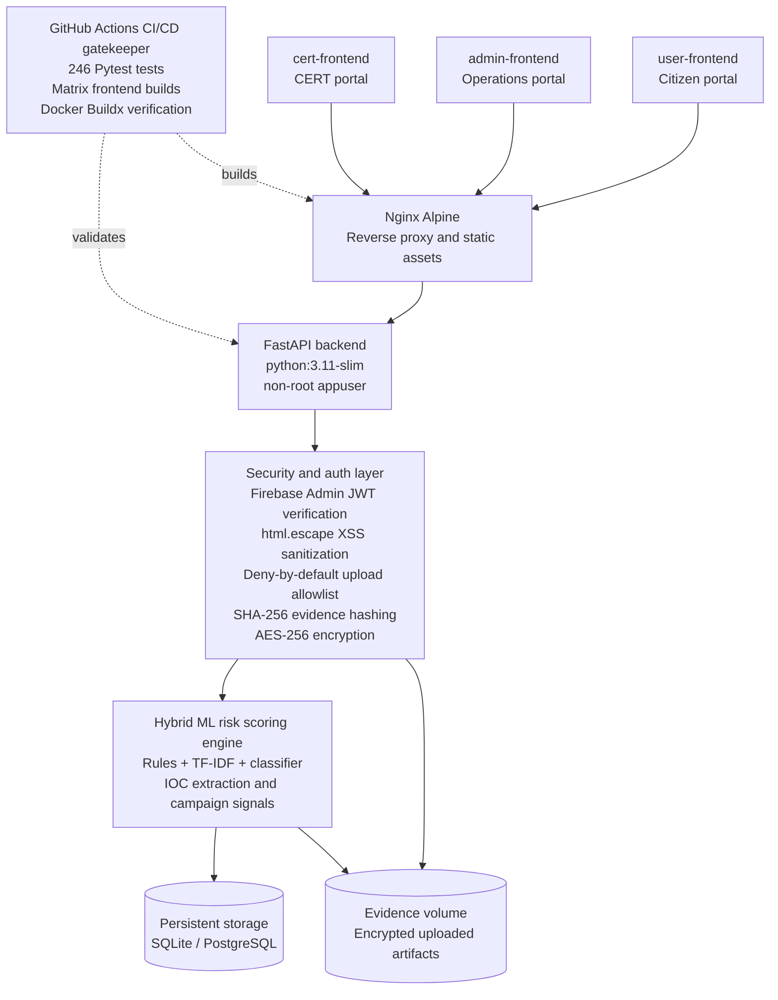

# Rakshak AI

[](https://github.com/boomeshh/ai-cyber-safety-portal-defence/actions/workflows/ci.yml)

## Project overview

Rakshak AI is a **Zero-Trust Defence Cyber-Incident & Threat Triage Portal**. It gives citizens, administrators, and cyber emergency response teams a controlled workflow for submitting suspicious content, preserving evidence, classifying threats, scoring risk, and coordinating response.

The platform combines three role-specific React portals with a FastAPI API, Firebase-backed identity, hybrid machine-learning analysis, auditable case management, and evidence storage. Its operating model is:

**Report → Verify → Sanitize → Analyze → Score → Triage → Respond**

Live deployments: [rakshakai.online](https://www.rakshakai.online) · [admin.rakshakai.online](https://admin.rakshakai.online)

## System architecture



### Request and trust boundaries

All portal traffic enters through the reverse proxy. The API does not trust client-supplied identity, file metadata, HTML, or risk assertions: it verifies Firebase Admin JWTs, applies role checks, sanitizes user-controlled text, validates uploads against an explicit allowlist, hashes evidence, and encrypts protected data before persistence.

## Repository structure

```text
.
├── .github/
│   └── workflows/
│       └── ci.yml
├── admin-frontend/       # Admin and management React portal
├── backend/              # FastAPI API, ML engine, models, and tests
│   └── tests/            # Backend security and feature tests
├── cert-frontend/        # Cyber emergency response team React portal
├── user-frontend/        # Citizen reporting React portal
├── screenshots/          # Product screenshots
├── docker-compose.yml    # Local backend + user portal orchestration
├── LOCALHOST_SETUP.md    # Local environment notes
└── README.md
```

## Security engineering highlights

- **Zero-trust authentication:** Firebase Admin verifies JWTs server-side; email verification and role-based access controls gate protected workflows.
- **XSS defense:** User-controlled text is escaped with `html.escape` before it is rendered or included in generated reports.
- **Evidence controls:** File uploads use a deny-by-default extension and MIME allowlist, bounded validation, SHA-256 integrity hashing, and authenticated access.
- **Confidentiality:** AES-256 encryption protects sensitive evidence and data at rest where configured.
- **Abuse resistance:** Authentication and sensitive API paths use rate limiting, security headers, and explicit error handling.
- **Accountability:** Administrative actions and security-relevant events are recorded in an audit trail.
- **ML safety:** Hybrid rules and ML signals produce explainable risk prioritization; model retraining is guarded against replacing a model when quality degrades.

## Quickstart

### Local Docker Compose

Requires Docker Desktop with the Compose plugin.

```bash
docker compose up --build
```

Open the user portal at <http://localhost:3000> and the API health endpoint at <http://localhost:8000/>.

Stop the stack with:

```bash
docker compose down
```

Compose persists uploaded evidence in the `rakshak-evidence` named volume.

### Manual development

The following commands run the API and each React portal independently. Use separate terminals.

```powershell
# Backend
cd backend
py -m venv venv
.\venv\Scripts\Activate.ps1
python -m pip install -r requirements.txt
uvicorn main:app --reload --host 127.0.0.1 --port 8000
```

```powershell
# User portal
cd user-frontend
npm install
npm start
```

```powershell
# Admin portal
cd admin-frontend
npm install
npm start
```

```powershell
# CERT portal
cd cert-frontend
npm install
npm start
```

Configure frontend API and Firebase values using the environment variables documented by each portal. Never commit credentials; use `.env.example` as the template.

## Testing and CI

Run the backend suite locally:

```bash
py -m pytest backend/tests/ -q
```

The CI gatekeeper runs the 246-test backend suite, builds all three frontends through a Node matrix, and verifies container builds with Docker Buildx. Pull requests targeting `main` must pass all required jobs.

## Technology stack

| Layer | Technologies |
| --- | --- |
| Portals | React, React Router, Firebase client SDK |
| Edge | Nginx Alpine reverse proxy and static asset server |
| API | FastAPI, Uvicorn, Python 3.11 |
| Analysis | scikit-learn TF-IDF, Logistic Regression, hybrid rules, IOC extraction |
| Storage | SQLite for local operation; PostgreSQL-compatible persistence; evidence volume |
| Delivery | Docker Compose, GitHub Actions, Docker Buildx |

## API surface

| Method | Endpoint | Purpose |
| --- | --- | --- |
| GET | `/health` | Health check |
| POST | `/register` | User registration |
| POST | `/login` | User login |
| POST | `/complaints` | Submit a complaint with evidence |
| GET | `/my-complaints/{id}` | Retrieve a user's complaint history |
| GET | `/admin/overview` | Admin dashboard data |
| GET | `/public/awareness` | Public anonymized statistics |
| GET | `/admin/complaints/{id}/report` | Generate an incident report |

## Contributing

Keep changes scoped, add focused tests for behavior changes, and run the backend test suite before opening a pull request. Security-sensitive changes should include the threat model, affected trust boundary, and validation strategy in the pull request description.

## License and ownership

Rakshak AI is maintained by [Boomesh](https://github.com/boomeshh). Refer to the repository license and contribution policy for project-specific terms.
